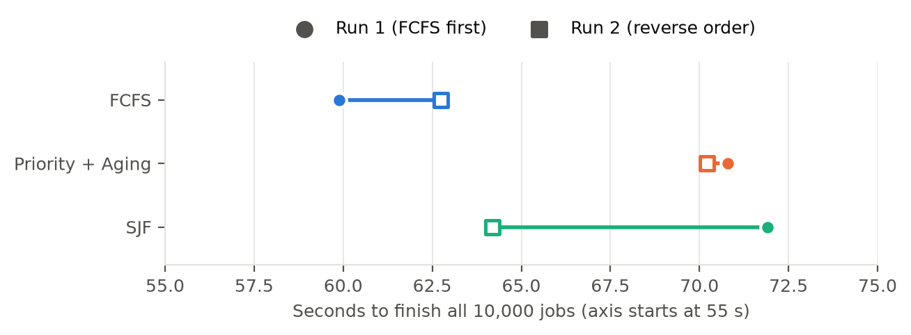
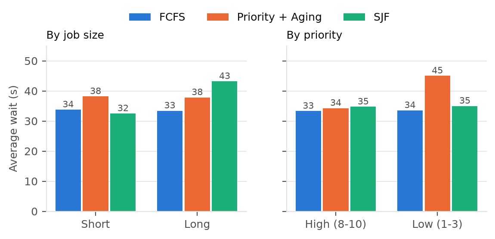
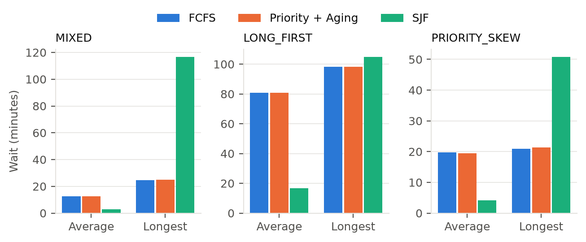

# QueuePilot Scheduling Benchmark Report

FCFS vs Priority with Aging vs SJF on a pool of 10,000 jobs. 6 November 2026.

## 1. Summary

We ran a pool of **10,000 jobs** through FCFS, Priority with Aging and SJF in two ways: the **simulator**, and the **real backend** (HTTP API, database, scheduler and 4 worker processes). All 60,000 real jobs succeeded with no retries and no errors during the runs.

- **In simulation, SJF wins on average wait, by 4.6x to 4.8x, but makes some jobs wait far longer.** On MIXED its longest wait was 6,997 s, against 1,475 s for FCFS.
- **In the real backend, that SJF advantage mostly disappears.** Average wait was 37.9 / 32.5 s for SJF and 32.9 / 34.5 s for FCFS, so neither clearly won.
- **Several things hold SJF back in the backend:** the scheduler only looks at the 500 oldest waiting jobs, and jobs here run about as long as it takes to dispatch them. A fixed pool probably also gives SJF less to gain than an overloaded stream of arrivals.
- **Completion time barely depends on the algorithm.** All three finish within 0.1% of each other in simulation. The real runs took 60-63 s (FCFS), 64-72 s (SJF) and 70-71 s (Priority + Aging), and SJF alone varied by 8 s between runs.
- **Priority with Aging does what it promises in the real backend:** high-priority jobs waited about 11 s less than low-priority jobs in both runs.

| Goal | Best choice | Evidence |
|---|---|---|
| Lowest average wait | SJF (simulation only) | 4.6x lower than FCFS on MIXED; no clear gain in the backend |
| Fairest, no starvation | FCFS | Longest wait on MIXED: 1,475 s vs 6,997 s for SJF |
| Important jobs first | Priority + Aging | Backend: priority 8-10 waited about 11 s less than priority 1-3 |
| Fastest completion | No clear winner | Same in simulation; backend gaps are close to run-to-run noise |

**Recommendation:** use Priority with Aging when jobs have meaningful priorities, and FCFS otherwise. Do not expect SJF's simulated gains in QueuePilot on backlogs this large, especially while the 500-job limit stays in place.

## 2. How the test was run

|  | Real backend | Simulator |
|---|---|---|
| Jobs | 10,000 per algorithm, same pool each time | 10,000 per scenario, same jobs for each algorithm |
| Job mix | `monte-carlo-pi`: 75% short, 25% long, priorities 1-10 | MIXED, LONG_FIRST and PRIORITY_SKEW scenarios |
| Job run time | About 7 ms short, 34 ms long (measured) | MIXED: 0.2-1.5 s short, 4-15 s long (declared) |
| Arrivals | Whole pool queued before workers start | Spread over time, set by the scenario |
| Workers | 4 real processes, 1 slot each | 4 simulated workers |
| Aging | 1 level per 5 s (coordinator default) | 1 level per 5 s, to match |
| Repeats | 2 full runs: FCFS first, then reverse order | 1 run, seed 42 |
| Database | Fresh H2 file database for every algorithm | None (virtual clock) |

**Test machine:** Intel Core i5-12500H (16 logical CPUs), 15 GB RAM, Linux, Java 27, on 6 November 2026. Code: commit `029ae46` plus the uncommitted 4-worker limit. An idle QueuePilot demo was running on the same machine.

**Why two runs in the backend:** the first run suggested SJF was slower than FCFS. The second run, in reverse order, reversed that, which showed the gap was noise. Backend tables show **run 1 / run 2**.

**Metrics:** wait is the time until a job starts, and turnaround is the time until it finishes. Backend times are measured from the moment the first job started, because the whole pool was already queued. Utilization is the share of worker time spent running jobs. Slowdown is turnaround divided by run time, so 1x means no waiting.

## 3. Real backend results

**Table 1. Real backend, 10,000 jobs, 4 workers (run 1 / run 2)**

| Metric | FCFS | Priority + Aging | SJF |
|---|---|---|---|
| Finish all jobs (s) | 59.9 / 62.7 | 70.8 / 70.2 | 71.9 / 64.2 |
| Throughput (jobs/s) | 167 / 159 | 141 / 142 | 139 / 156 |
| Worker utilization | 57% / 56% | 55% / 51% | 51% / 53% |
| Average wait (s) | 32.9 / 34.5 | 38.9 / 37.3 | 37.9 / 32.5 |
| Median wait (s) | 33.3 / 35.2 | 39.5 / 36.9 | 40.5 / 33.3 |
| p95 wait (s) | 57.3 / 61.0 | 68.0 / 68.3 | 63.9 / 56.6 |
| p99 wait (s) | 59.4 / 62.4 | 70.3 / 69.9 | 70.2 / 62.6 |
| Longest wait (s) | 59.9 / 62.7 | 70.8 / 70.2 | 71.9 / 64.2 |
| Average turnaround (s) | 32.9 / 34.5 | 38.9 / 37.3 | 38.0 / 32.5 |
| Average run time (ms) | 13.6 / 14.1 | 15.4 / 14.2 | 14.8 / 13.6 |
| Wait, short jobs (s) | 32.9 / 34.6 | 39.0 / 37.4 | 35.1 / 29.9 |
| Wait, long jobs (s) | 32.6 / 34.2 | 38.6 / 37.0 | 46.3 / 40.1 |
| Wait, priority 8-10 (s) | 32.5 / 34.1 | 35.1 / 33.5 | 37.4 / 32.0 |
| Wait, priority 1-3 (s) | 32.7 / 34.3 | 45.8 / 44.2 | 37.7 / 32.3 |
| Jobs succeeded | 10,000 / 10,000 | 10,000 / 10,000 | 10,000 / 10,000 |
| Retries | 0 / 0 | 0 / 0 | 0 / 0 |



*Figure 1. Time to finish the pool. Each line joins one algorithm's two runs.*

**Completion time.** FCFS was quickest in both runs and Priority + Aging took about 70 s both times, but SJF alone moved by 8 s between runs. Two runs are too few to rank them with confidence.

**Backend speed.** The system ran 139-167 jobs/s and accepted 695-933 submissions/s. Workers were busy only 51-57% of the time, because each job needed about 10-14 ms of dispatch overhead on top of a run time of about 14 ms.



*Figure 2. Average wait by job type, mean of both runs.*

**Who waits.** This is where the algorithms really differ, and both runs agree. FCFS treats everyone the same. SJF makes long jobs wait 10-11 s longer than short ones. Priority with Aging makes low-priority jobs wait about 11 s longer than high-priority ones.

## 4. Simulation results

The simulator uses the same scheduling code but has no network, database or 500-job limit, so it shows each algorithm's ordering effect alone.



*Figure 3. Average and longest wait in each simulated scenario.*

### MIXED

Random arrivals, 75% short and 25% long jobs. Arrivals exceed capacity by about 25%, so the queue keeps growing.

**Table 2. Simulation, MIXED, 10,000 jobs, 4 workers**

| Metric | FCFS | Priority + Aging | SJF |
|---|---|---|---|
| Finish all jobs (s) | 7,435 | 7,432 | 7,432 |
| Average wait (s) | 754 | 754 | 163 |
| Median wait (s) | 847 | 850 | 1.3 |
| p95 wait (s) | 1,410 | 1,415 | 333 |
| p99 wait (s) | 1,465 | 1,470 | 4,919 |
| Longest wait (s) | 1,475 | 1,491 | 6,997 |
| Average turnaround (s) | 757 | 757 | 166 |
| Average slowdown (x) | 898.7 | 899.2 | 14.5 |
| Wait, short jobs (s) | 753 | 753 | 1.9 |
| Wait, long jobs (s) | 757 | 757 | 655 |
| Wait, priority 8-10 (s) | 761 | 741 | 166 |
| Wait, priority 1-3 (s) | 755 | 775 | 156 |

### LONG_FIRST

A burst of long jobs arrives just before many short ones. All jobs have the same priority, so Priority + Aging matches FCFS exactly.

**Table 3. Simulation, LONG_FIRST, 10,000 jobs, 4 workers**

| Metric | FCFS | Priority + Aging | SJF |
|---|---|---|---|
| Finish all jobs (s) | 6,315 | 6,315 | 6,317 |
| Average wait (s) | 4,854 | 4,854 | 1,001 |
| Median wait (s) | 5,331 | 5,331 | 452 |
| p95 wait (s) | 5,838 | 5,838 | 4,864 |
| p99 wait (s) | 5,883 | 5,883 | 6,001 |
| Longest wait (s) | 5,895 | 5,895 | 6,291 |
| Average turnaround (s) | 4,856 | 4,856 | 1,004 |
| Average slowdown (x) | 7,573.2 | 7,573.2 | 401.3 |
| Wait, short jobs (s) | 5,445 | 5,445 | 346 |
| Wait, long jobs (s) | 2,488 | 2,488 | 3,622 |

### PRIORITY_SKEW

Early low-priority long jobs, then a steady stream of high-priority short jobs.

**Table 4. Simulation, PRIORITY_SKEW, 10,000 jobs, 4 workers**

| Metric | FCFS | Priority + Aging | SJF |
|---|---|---|---|
| Finish all jobs (s) | 3,055 | 3,055 | 3,057 |
| Average wait (s) | 1,188 | 1,169 | 246 |
| Median wait (s) | 1,253 | 1,251 | 0.2 |
| p95 wait (s) | 1,256 | 1,260 | 2,425 |
| p99 wait (s) | 1,256 | 1,261 | 2,923 |
| Longest wait (s) | 1,257 | 1,286 | 3,047 |
| Average turnaround (s) | 1,190 | 1,170 | 247 |
| Average slowdown (x) | 1,556.1 | 1,525.4 | 53.0 |
| Wait, short jobs (s) | 1,251 | 1,225 | 4.6 |
| Wait, long jobs (s) | 623 | 660 | 2,419 |
| Wait, priority 8-10 (s) | 1,251 | 1,222 | 4.6 |
| Wait, priority 1-3 (s) | 623 | 660 | 2,419 |

**What stands out:**

- **SJF's cost is starvation.** On MIXED its median wait is 1.3 s against 847 s for FCFS, but its p99 wait is 4,919 s against 1,465 s.
- **Priority + Aging behaves almost like FCFS here.** Waits reach hundreds of seconds, while nine priority levels equal only 45 s of aging, so age soon outweighs priority. A slower aging rate would make priority count for more.
- **Completion time does not change.** Workers stay busy under every algorithm, and the total work is the same, so only the order of jobs differs.

## 5. Why the backend and simulator disagree

**Cause 1: the 500-job window.** `SchedulerService` fetches only the 500 oldest waiting jobs (`CANDIDATE_LIMIT = 500`) and applies the policy to those. Under SJF the first 1,000 jobs started were all short, yet none came from beyond position 1,498 of the pool. SJF was choosing among the oldest jobs, not the whole pool.


*Figure 4. Order jobs started vs their position in the pool (run 1). Every point is one job. A straight diagonal is first-come order. Points above the line are jobs that were delayed. No point sits far below the line, because no job can jump more than about 500 places ahead.*

**Cause 2: very short jobs.** Dispatch overhead was about as large as the average job, so running short jobs first saves less than it does in the simulator, where jobs last seconds.

**Likely cause 3: a fixed pool.** We did not test this one directly. In the simulator's overloaded scenarios, jobs keep arriving, so SJF can keep serving new short jobs while long ones wait until the end. In a fixed pool every job has to run within the same short period, so the possible gain should be smaller.

To estimate how much the window matters, we replayed each SJF run's measured job times with a fixed overhead per job, with and without the window:

**Table 5. Modelled estimate, not a measurement**

| Replay, average wait (s) | Run 1 | Run 2 |
|---|---|---|
| FCFS order | 37.4 | 33.4 |
| SJF with 500-job window | 34.2 | 30.3 |
| SJF seeing the whole pool | 29.1 | 25.6 |
| Measured SJF, for comparison | 37.9 | 32.5 |

Removing the window would cut SJF's average wait by roughly 15% in this model. The model is optimistic: it came in 2.2-3.7 s below the measured SJF result, so treat this as a rough size only. Even seeing the whole pool, SJF beats FCFS by only about 22-23% in the replay, far from the simulator's 4.6x, so the window is only part of the explanation. Raising the limit also has a cost, since every claim would load more rows.

## 6. Limitations

- **Few repeats.** The backend ran twice and the simulator once, so small differences should not be read as real. There are no confidence intervals.
- **Backend jobs are tiny.** They last milliseconds so that 10,000 jobs finish in about a minute. At the simulator's job lengths, one backend run would take about 2 hours per algorithm. Longer jobs would probably show more of SJF's gain, but we did not test that.
- **Backend estimates are accurate.** `estimatedMs` is proportional to the job's real size, and the simulator gives SJF exact durations. Real estimates would be worse, and that would hurt SJF.
- **One machine, one database.** All processes shared one machine and used H2. PostgreSQL or several machines could give different speeds.
- **Aging started during submission.** Early jobs had aged by up to about 14 s before workers started, which slightly favours them under Priority + Aging.
- **Backend and simulator figures are not directly comparable.** Their job lengths and arrival patterns differ, so compare the algorithms within each one.

## 7. How to reproduce

```bash
# Simulation
java -jar target/benchmarks/queuepilot-benchmarks-1.0.0.jar simulate \
  --jobs 10000 --workers 4 --seed 42 --seeds 1 --aging-interval-ms 5000

# Real backend, run 1 and run 2
python3 scripts/benchmark_pipeline.py --jobs 10000 --workers 4 --seed 42
python3 scripts/benchmark_pipeline.py --jobs 10000 --workers 4 --seed 42 \
  --policies SJF,PRIORITY_AGING,FCFS --out benchmark-results/report-pipeline-repeat
```

Raw per-job data is in `benchmark-results/`, which git ignores. The backend script uses its own port and a temporary database, so it does not touch a running demo.
