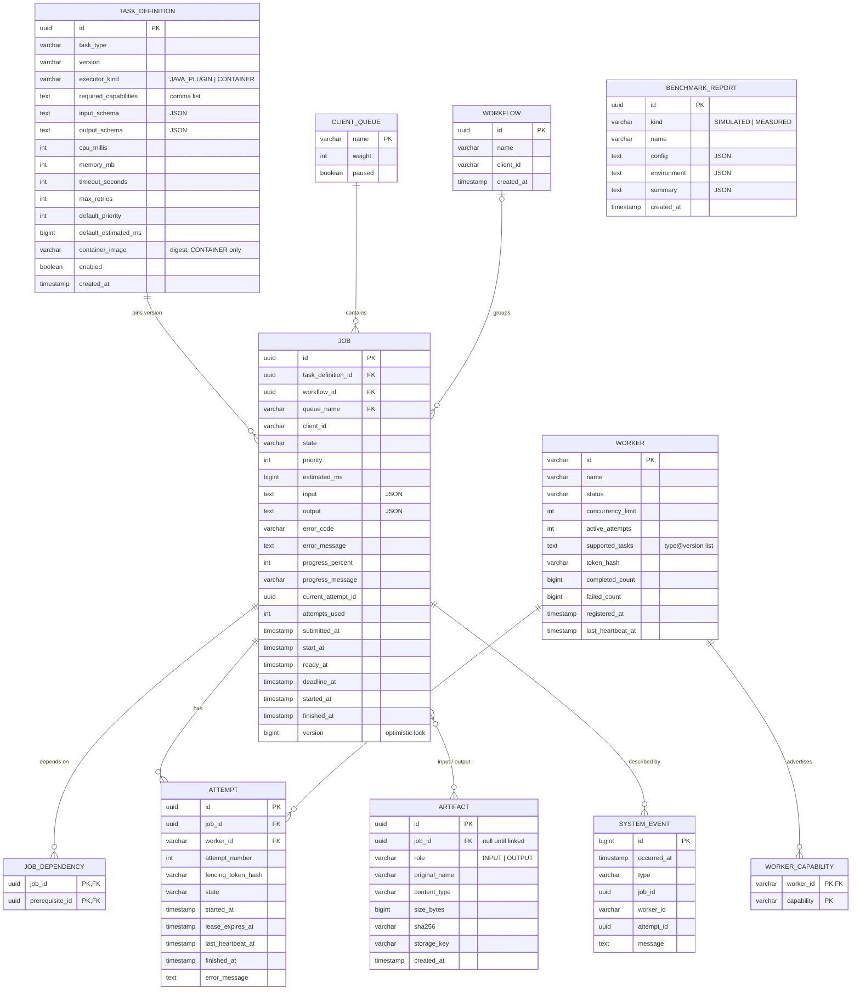

# Database Model

PostgreSQL is the **source of truth** (ADR-004). Schema is created by Flyway SQL migrations (`db/migration/V1__init.sql` …), never by Hibernate `ddl-auto`. JSON payloads are stored as `TEXT` so the same SQL runs on H2 (PostgreSQL mode) in tests.

## Notes

- **Indexes:** `job(state, ready_at)`, `job(client_id, state)`, `attempt(state, lease_expires_at)`, `worker(status, last_heartbeat_at)`, unique `task_definition(task_type, version)`.
- **Tokens are hashed** (SHA-256) — a database leak does not let anyone impersonate a worker or attempt.
- **Optimistic locking:** `job.version` is incremented by every update; a claim that loses a race gets an `OptimisticLockException` and the scheduler moves to the next candidate.
- **History:** the full story of a job is `attempt` rows + `system_event` rows; nothing is deleted during the project demonstration.
- **Artifacts** hold metadata only; bytes live under `./data/artifacts/<storage_key>` where `storage_key` is a generated UUID, never a user-supplied name.
- **Benchmark reports** are imported from files produced by `queuepilot-benchmarks`; the raw CSV stays on disk and is referenced, not copied into the DB.
