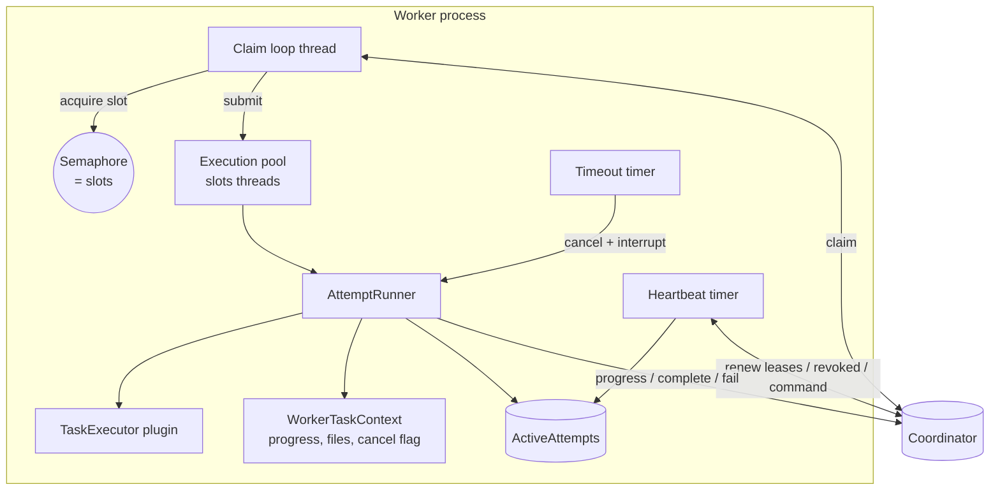
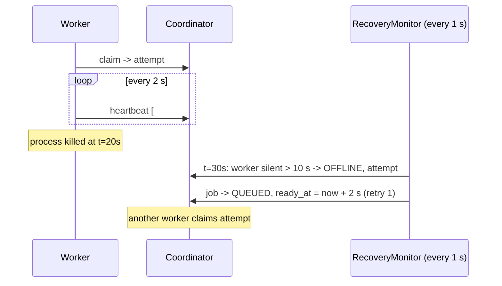

# Workers, Leases and Retries

**Purpose.** Execute tasks outside the coordinator and still know, at all times, which execution is the real one (U4, U5, F9-F11, F18).

## Worker process



| Class | Responsibility |
|---|---|
| `WorkerMain`, `WorkerConfig` | Parse options, load plugins, start runtime, shutdown hook |
| `WorkerRuntime` | Registration (with retry), claim loop, heartbeats, commands, graceful stop |
| `AttemptRunner` | One attempt: choose executor, enforce timeout, report outcome, clean scratch dir |
| `WorkerTaskContext` | The plugin's `TaskContext`; throttles progress to ≤ 2 calls/s; records why an attempt was cancelled |
| `TaskExecutorRegistry` | `ServiceLoader` discovery of built-ins and jars in `plugins/` |
| `HttpCoordinatorClient` | The protocol over `java.net.http.HttpClient` |

The semaphore guarantees a worker never holds more attempts than it advertised; the coordinator checks the same limit independently.

## Attempt identity: the fencing token

Every claim creates an `attempt` row with a random **fencing token** (only its SHA-256 is stored). A worker update is applied only when **all** hold:

1. the attempt is `RUNNING`,
2. it belongs to the calling worker (bearer token),
3. the presented token matches,
4. it is the job's `current_attempt_id`.

Otherwise the coordinator answers **409 STALE_ATTEMPT**, records `STALE_UPDATE_REJECTED`, and changes nothing. That is how "an old worker cannot overwrite a newer attempt" is enforced.

## Lease timeline



| Timer | Default | Who enforces |
|---|---|---|
| Heartbeat interval | 2 s | worker |
| Lease | 10 s after the last heartbeat or progress report | coordinator |
| Worker offline after silence | 10 s | coordinator |
| Task timeout | per task definition (`timeoutSeconds`) | both: worker stops the task locally; coordinator times out the attempt even if the worker hangs |

Worst-case failure detection = worker timeout + one monitor interval ≈ 11 s (NFR3).

## Retry decision (`AttemptService.endAttempt`)

```
attempt ends with outcome O (FAILED, TIMED_OUT, LEASE_EXPIRED, ABANDONED)
if O is retryable and attemptsUsed <= maxRetries:
    job -> QUEUED, ready_at = now + base * 2^(attemptsUsed-1)  (capped at 60 s)
else:
    job -> FAILED; dependants -> SKIPPED
```

Retryable: lease expiry, abandonment, timeouts, unexpected exceptions and `TaskFailure.retryable`. Permanent: `TaskFailure.permanent` (e.g. input that passes the schema but is unusable) and oversize output. With the built-in default `maxRetries = 3` a job runs at most 4 times.

## Failure simulation

| Button | Mechanism | What you should see |
|---|---|---|
| Simulate crash | `KILL` delivered on next heartbeat; worker calls `Runtime.halt(137)` | Worker OFFLINE, attempt ABANDONED, job retried elsewhere |
| Freeze heartbeats | `FREEZE`; worker keeps computing but stops heartbeating | Lease expires, retry elsewhere, frozen worker's late `complete` rejected with 409 |
| Drain | No new claims; current attempts finish | Slots empty out |

## Guarantees (and non-guarantees)

- At-least-once execution with bounded retries. A job can run twice (e.g. frozen worker finishes after a retry started). Built-in tasks are pure computations, so this is harmless.
- First valid completion from the **current** attempt wins; nothing else can change the job.
- No exactly-once, no multi-coordinator.

## Tests

`ExecutionAndRecoveryTest` (lease expiry + fencing, retry limit, permanent failure, offline detection, timeout, kill command, drain), `WorkerRuntimeTest` (slot limit, failure flags, local timeout, revocation), and the live end-to-end run in [testing-strategy.md](../testing/testing-strategy.md).
